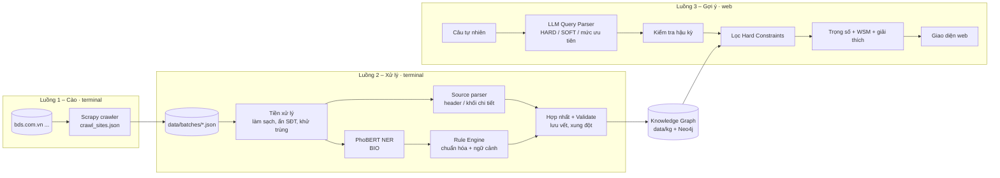

# Hệ thống tìm kiếm & gợi ý nhà ở trên toàn quốc

Hiện thực theo đề cương *"Nghiên cứu phương pháp trích xuất thông tin bất động sản từ dữ liệu phi cấu trúc và xây dựng hệ thống gợi ý cá nhân hóa dựa trên mức độ ưu tiên của người dùng"* (nhóm EM ANH TRỌNG – DHHTTT19BTT).

Hệ thống gồm **3 luồng chạy độc lập**, nối với nhau qua thư mục `data/`:

| Luồng | Việc làm | Chạy ở | Lệnh | Đầu vào → Đầu ra |
|---|---|---|---|---|
| **1. Cào dữ liệu** | Thu thập **toàn bộ** tin rao từ các web | Terminal | `python scripts/crawl.py` | Web → `data/batches/*.json` |
| **2. Xử lý dữ liệu** | PhoBERT + NER + Rule Engine → JSON có cấu trúc → Knowledge Graph (+ Neo4j) | Terminal | `python scripts/process.py` | `data/batches/` → `data/processed/`, `data/kg/`, Neo4j |
| **3. Gợi ý** | Người dùng nhập yêu cầu tự nhiên → LLM phân tích, lọc điều kiện bắt buộc, gán trọng số → đề xuất tin | **Web** | `docker compose up -d` | Câu yêu cầu + `data/kg/` → danh sách tin có giải thích |



Các luồng không gọi lẫn nhau: luồng 1 chỉ ghi file vào `data/batches/`; luồng 2 đọc thư mục đó và ghi Knowledge Graph; luồng 3 chỉ đọc Knowledge Graph và **tự nạp lại** mỗi khi luồng 2 chạy xong (không cần khởi động lại web).

---

## Cài đặt (làm 1 lần)

Chọn **một** trong hai cách. Docker được khuyên dùng vì chạy giống nhau trên Windows, macOS, Linux và không cần cài Python.

### Cách A — Docker (Windows / macOS / Linux)

**1. Cài Docker Desktop**

| Hệ điều hành | Cách cài |
|---|---|
| **Windows 10/11** | Tải *Docker Desktop for Windows* tại https://www.docker.com/products/docker-desktop/ → cài, chọn **Use WSL 2** khi được hỏi → khởi động lại máy nếu được yêu cầu. |
| **macOS** | Tải *Docker Desktop for Mac*, chọn đúng chip: **Apple Silicon** (M1/M2/M3/M4) hoặc **Intel** (menu Apple → About This Mac) → kéo vào Applications. |
| **Linux** | Cài Docker Engine + Compose plugin theo https://docs.docker.com/engine/install/ |

Mở **Docker Desktop**, chờ đến khi báo *Engine running*. Kiểm tra trong terminal (Windows: PowerShell, macOS: Terminal):

```bash
docker --version
docker compose version
```

**2. Mở terminal tại thư mục dự án**

```bash
# Windows (PowerShell)
cd "D:\duong\dan\toi\RealEstateAutomation"
# macOS / Linux
cd ~/duong/dan/toi/RealEstateAutomation
```

**3. (Tùy chọn) Tạo file `.env`** — chỉ cần nếu dùng LLM (Claude) để phân tích câu yêu cầu, hoặc muốn đổi cổng web:

```bash
copy .env.example .env      # Windows
cp .env.example .env        # macOS / Linux
```

Mở `.env`, điền `ANTHROPIC_API_KEY=sk-ant-...`; đổi `APP_PORT=8090` nếu cổng 8080 đã bị chiếm. Không có API key thì hệ thống dùng bộ phân tích bằng luật.

**4. Build image và bật web + Neo4j**

```bash
docker compose up -d --build
```

Lần đầu mất vài phút (tải image Python + Neo4j). Lệnh này bật **luồng 3 (web)** và **Neo4j**. Hai luồng còn lại chạy bằng lệnh `docker compose run --rm app ...` như bên dưới — mỗi lần chạy tạo một container tạm dùng chung image, xong tự xóa.

### Cách B — Python trực tiếp (không Docker)

Yêu cầu Python ≥ 3.10.

```bash
python -m venv .venv
.venv\Scripts\Activate.ps1                     # Windows  (macOS/Linux: source .venv/bin/activate)
python -m pip install -r requirements.txt      # lõi: crawler, Rule Engine, LLM, KG, Neo4j driver, web
python -m pip install -r requirements-ml.txt   # tùy chọn: PhoBERT (torch, transformers)
copy .env.example .env                         # tùy chọn (macOS/Linux: cp)
```

Neo4j vẫn có thể chạy bằng Docker: `docker compose up -d neo4j`. Mỗi lần mở terminal mới cần kích hoạt lại `.venv`.

---

## Luồng 1 — Cào dữ liệu (terminal)

```bash
# Docker
docker compose run --rm app python scripts/crawl.py
# Python
python scripts/crawl.py
```

| Tùy chọn | Ý nghĩa |
|---|---|
| *(không có)* | Cào các web đang bật, **cào hết tin** (tới khi web không còn trang nào) |
| `--limit 5000` | Giới hạn tối đa 5000 tin mỗi web |
| `--sites bds --limit 100` | Chọn web / số tin (thử nhanh) |
| `--jobdir data/crawl_job` | Có thể `Ctrl + C` để dừng, chạy lại cùng lệnh để cào tiếp |

Kết quả: mỗi web một file `data/batches/<web>_<YYYYmmdd_HHMMSS>.json` (cùng định dạng bộ dữ liệu gốc: `_id`, `url`, `text`, `source`, `crawled_at`).

**Vì sao thấy file `.jsonl.part`?** Trong lúc cào, mỗi tin được ghi ngay vào `<web>_<thời gian>.jsonl.part` để dừng giữa chừng không mất dữ liệu. Chỉ khi cào **xong** (đủ số tin) hoặc dừng êm bằng **một lần** `Ctrl + C`, file mới đổi thành `.json`. Luồng 2 **chỉ đọc file `.json`/`.jsonl`**, bỏ qua `.part` (dữ liệu chưa hoàn tất).

* Nếu crawler bị dừng đột ngột (`Ctrl + C` hai lần, tắt terminal/máy) → file `.part` ở lại → chạy `python scripts/crawl.py --finalize` để chuyển thành `.json`. Chỉ chạy khi không còn crawler nào đang chạy.
* **Không chạy 2 crawler cùng lúc** cho cùng một web (vừa gấp đôi tải lên web, vừa lãng phí). Crawler mới vẫn bỏ qua URL đã có trong các file `.part` nên không lưu trùng.

Xem tiến độ khi cào lâu (Python, ghi log ra file):

```powershell
python scripts/crawl.py --jobdir data/crawl_job > data/logs/crawl.log 2>&1
Get-Content data\logs\crawl.log -Tail 5 -Wait          # Windows
tail -f data/logs/crawl.log                            # macOS / Linux
```

* Không cào lại URL đã có trong `data/batches/`. Dừng khi web hết tin (trang danh sách rỗng hoặc lặp lại trang trước), hoặc khi đủ `--limit`.
* Giới hạn mặc định đặt trong `crawl_sites.json`: `default_limit` (0 = không giới hạn) và `max_pages` của từng web (`null` = không giới hạn trang).
* Cấu hình web (URL phân trang/sitemap, selector, bật/tắt): `src/realestate/rules/crawl_sites.json`.
* Cào có trách nhiệm: tuân thủ `robots.txt`, khoảng 1 request/giây/web, User-Agent khai báo rõ là bot nghiên cứu. Web nào từ chối bot (403, hoặc liên tục chuyển hướng về trang chủ) sẽ tự bị dừng — **không** giả danh trình duyệt hay vượt cơ chế chặn.
* Muốn lưu thêm vào MongoDB: đặt biến môi trường `MONGO_URI=mongodb://127.0.0.1:27017`.

| Web | Trạng thái | Ghi chú |
|---|---|---|
| bds.com.vn | bật | phân trang HTML, khoảng 3.000–6.000 trang × 20 tin (~60.000–120.000 tin). Cào hết mất **1–2 ngày** ở tốc độ ~1 request/giây — nên dùng `--jobdir` để dừng/chạy tiếp |
| radanhadat.vn | tắt | sitemap công khai có ~830 tin nhưng trang chi tiết chuyển hướng bot về trang chủ |
| batdongsan.com.vn | tắt | trả 403 (chống bot) |

Có dữ liệu từ nguồn khác: chỉ cần thả file `.json` / `.jsonl` vào `data/batches/` (mỗi tin cần trường `text`/`content`/`description`, nên có `url`), rồi chạy luồng 2.

## Luồng 2 — Xử lý dữ liệu (terminal)

```bash
# Docker
docker compose run --rm app python scripts/process.py
# Python
python scripts/process.py
```

Lệnh này đọc mọi file trong `data/batches/`, chạy **tiền xử lý → tách header theo nguồn → PhoBERT NER (nếu đã huấn luyện) + Rule Engine → hợp nhất & kiểm tra hợp lệ**, rồi ghi:

* `data/processed/properties.jsonl` — bản ghi có cấu trúc + dấu vết trích xuất (bằng chứng, nguồn, độ tin cậy, xung đột);
* `data/kg/graph.pkl` — Knowledge Graph;
* Neo4j — nếu đang chạy (bỏ qua bằng `--no-neo4j`).

| Tùy chọn | Ý nghĩa |
|---|---|
| *(không có)* | Chỉ xử lý **tin mới** (bỏ tin đã xử lý, trùng URL/nội dung) |
| `--rebuild` | Xử lý lại **toàn bộ** từ đầu — dùng sau khi sửa luật trong `src/realestate/rules/*.json` |
| `--mode rule\|bert\|hybrid` | Chọn cấu hình trích xuất (mặc định `hybrid`; chưa có model PhoBERT thì tự dùng `rule`) |

Kết thúc, lệnh in độ phủ từng thuộc tính. Web (luồng 3) tự nạp dữ liệu mới.

**Huấn luyện PhoBERT** (tùy chọn, cần `requirements-ml.txt`, nên chạy bằng Python trên máy có GPU):

```bash
python scripts/build_ner_dataset.py        # Rule Engine gán nhãn BIO "bạc" + chia train/dev/test
#  -> nhóm hiệu chỉnh tay data/annotations/to_annotate_test.jsonl thành gold_test.jsonl
python scripts/train_ner.py --epochs 5     # tinh chỉnh vinai/phobert-base-v2 -> models/phobert-ner
python scripts/process.py --rebuild --mode hybrid
python scripts/evaluate.py ner --gold data/annotations/gold_test.jsonl   # so sánh Rule-only / BERT-only / BERT+Rule
```

## Luồng 3 — Gợi ý trên web

```bash
# Docker (đã bật ở bước cài đặt; bật lại nếu đã tắt)
docker compose up -d
# Python
uvicorn realestate.api.app:app --app-dir src --port 8001
```

| Thành phần | Docker | Python |
|---|---|---|
| Web tìm & gợi ý nhà | http://localhost:8080 | http://127.0.0.1:8001 |
| Tài liệu API (Swagger) | http://localhost:8080/docs | http://127.0.0.1:8001/docs |
| Neo4j Browser | http://localhost:7474 (`neo4j` / `realestate123`) | như bên trái |

Trên web: nhập yêu cầu bằng tiếng Việt tự nhiên (vd *"căn hộ Hà Nội tối đa 4 tỷ, 2 phòng ngủ, ưu tiên có ban công"*) → **Tìm nhà**. Kết quả gồm:

1. **Bảng tiêu chí đã phân tích**: mỗi tiêu chí là **HARD** (bắt buộc, dùng để lọc) hay **SOFT** (mong muốn, dùng để chấm điểm), toán tử (≈, ≥, ≤, khoảng…), mức ưu tiên, **trọng số**, độ tin cậy, đoạn trích làm bằng chứng, cờ *cần xác nhận*;
2. **Danh sách tin đề xuất** xếp theo điểm WSM, kèm độ bao phủ dữ liệu và giải thích (điều kiện đã thỏa, tiêu chí đóng góp nhiều nhất, tiêu chí làm giảm điểm, dữ liệu còn thiếu);
3. Nhóm **"chưa đủ dữ liệu để xác minh"** tách riêng.

Có thể chọn *trọng số* (theo mức ưu tiên / bằng nhau), *bộ phân tích* (tự động / LLM / luật) và hệ số λ để so sánh.

Thử nhanh không cần web:

```bash
docker compose run --rm app python scripts/recommend_cli.py "Tôi cần một căn nhà ở Quận 3, diện tích 60 m2 thì càng tốt"
python scripts/recommend_cli.py "Tôi cần một căn nhà ở Quận 3, diện tích 60 m2 thì càng tốt"
```

---

## Chu trình thường dùng

```bash
# 1) cào thêm  ->  2) xử lý phần mới  ->  3) web tự cập nhật, chỉ việc tải lại trang
docker compose run --rm app python scripts/crawl.py
docker compose run --rm app python scripts/process.py

# Sửa luật trích xuất (src/realestate/rules/*.json) -> xử lý lại toàn bộ
docker compose run --rm app python scripts/process.py --rebuild

# Kiểm thử
docker compose run --rm app python -m pytest -q

# Quản lý container
docker compose logs -f app       # xem log web (Ctrl + C để thoát)
docker compose stop              # tạm dừng web + Neo4j
docker compose start             # chạy lại
docker compose down              # gỡ container (giữ dữ liệu Neo4j)
docker compose down -v           # gỡ cả dữ liệu Neo4j
docker compose up -d --build     # build lại sau khi sửa code Python / requirements
```

Thư mục `data/` và các file luật `src/realestate/rules/*.json` được chia sẻ trực tiếp giữa máy và container: sửa luật trên máy rồi chạy luồng 2 là có hiệu lực, không cần build lại image.

## Xử lý sự cố

| Hiện tượng | Cách xử lý |
|---|---|
| `Cannot connect to the Docker daemon` / `dockerDesktopLinuxEngine` | Chưa mở Docker Desktop, hoặc chưa chờ *Engine running*. |
| `port is already allocated` (8080, 7474, 7687) | Cổng bị chương trình khác dùng. Đổi `APP_PORT` trong `.env`; với Neo4j, dừng Neo4j khác. |
| Web báo *"Chưa có dữ liệu đã xử lý"* | Chưa chạy luồng 2: `docker compose run --rm app python scripts/process.py`. |
| Luồng 2 báo *Bỏ qua Neo4j* | Neo4j chưa bật hoặc đang khởi động: `docker compose up -d neo4j`, chờ 20–60 giây rồi chạy lại. |
| `python` mở Microsoft Store (Windows) | Settings → Apps → Advanced app settings → App execution aliases → tắt `python.exe`, `python3.exe`; mở lại terminal. |
| `Activate.ps1` báo lỗi ExecutionPolicy | `Set-ExecutionPolicy -Scope CurrentUser RemoteSigned` |
| macOS chip M báo lỗi nền tảng | Cập nhật Docker Desktop; image `python:3.11-slim` và `neo4j:5.26` đều có bản ARM64. |

---

## Cấu trúc dự án

```
RealEstateAutomation/
├── Dockerfile, docker-compose.yml, docker/entrypoint.py   # image dùng chung cho 3 luồng; container app = web
├── data/
│   ├── batches/                   # ★ dữ liệu thô (luồng 1 ghi, luồng 2 đọc) — mọi .json/.jsonl
│   ├── processed/properties.jsonl # (luồng 2) bản ghi có cấu trúc + dấu vết trích xuất
│   ├── kg/graph.pkl               # (luồng 2) Knowledge Graph — luồng 3 đọc
│   └── annotations/               # mẫu file gán nhãn cho đánh giá
├── scripts/
│   ├── crawl.py                   # LUỒNG 1
│   ├── process.py                 # LUỒNG 2 (= ingest.py + export_neo4j.py)
│   ├── recommend_cli.py           # luồng 3 dạng dòng lệnh
│   ├── ingest.py, export_neo4j.py # bước con của luồng 2 (chạy riêng khi cần)
│   └── build_ner_dataset.py, train_ner.py, evaluate.py
├── src/realestate/
│   ├── rules/                     # ★ TOÀN BỘ LUẬT (JSON), code chỉ thông dịch
│   │   ├── crawl_sites.json       #   luồng 1: cấu hình từng web cần cào
│   │   ├── source_templates.json  #   luồng 2: bố cục trang từng nguồn (header, khối "Chi tiết", địa chỉ)
│   │   ├── extraction_rules.json  #   luồng 2: luật trích xuất tiền, diện tích, phòng, tầng, hướng, pháp lý, vị trí...
│   │   ├── query_rules.json       #   luồng 3: HARD/SOFT, toán tử, mức ưu tiên, dung sai, bảng tương đồng
│   │   └── loader.py
│   ├── crawler/crawler/           # luồng 1: project Scrapy (spider, pipeline lưu JSON)
│   ├── preprocessing/             # luồng 2: làm sạch, ẩn PII, khử trùng, tách header theo nguồn
│   ├── extraction/                # luồng 2: rule_engine, ner_model (PhoBERT), weak_labeling, hybrid, validator
│   ├── kg/                        # Knowledge Graph (NetworkX) + export Neo4j + so khớp địa danh
│   ├── pipeline.py                # luồng 2: điều phối
│   ├── query/                     # luồng 3: LLM parser (Claude) + parser luật + kiểm tra hậu kỳ
│   ├── ranking/                   # luồng 3: lọc HARD, hàm tiện ích, trọng số, WSM, giải thích
│   ├── api/app.py, web/index.html # luồng 3: API + giao diện
│   ├── evaluation/metrics.py      # P/R/F1, HARD/SOFT macro-F1, P@K, R@K, NDCG@K, MRR
│   ├── schemas.py, config.py
└── tests/                         # pytest
```

---

## Chi tiết kỹ thuật

### Luồng 2 — Rule Engine dạng module JSON

Code không chứa luật. Muốn thêm/sửa luật chỉ cần sửa JSON (hoặc trỏ `EXTRACTION_RULES_PATH`, `QUERY_RULES_PATH`, `SOURCE_TEMPLATES_PATH` sang file khác để thử nghiệm). Regex viết theo cú pháp chung Python/JS: nhóm tên `(?<name>…)` (loader tự đổi thành `(?P<name>…)`), placeholder `{NUM}`, `{NL}`, `{NDB}`…

| Nhóm luật (extraction_rules.json) | Ví dụ xử lý |
|---|---|
| `money.patterns` | `8tỷ5`, `8 tỷ 500 triệu`, `2,99 tỷ`, `1.200 triệu`, `1tỷ199`, `3TY880triệu`, giá che số `2.x tỷ`, `5xx triệu` |
| `money.cues` + vai trò | cue gần nhất quyết định: `cọc trước 180 triệu` → DEPOSIT; `giảm còn 3ty880` → giá; `136 triệu vốn ban đầu`, `TN 100tr`, `xây 7 tỷ` → tiền khác; `/m2`, `/tháng`, `/công` → đơn giá / giá thuê |
| `money.approx_cues` | `nhỉnh 3 tỷ`, `chỉ hơn 900tr`, `7-8 tỷ` → xấp xỉ, độ tin cậy thấp để giá chính xác trong bài được ưu tiên |
| `area`, `dimensions` | `60 m2`, `80 m 2`, `1.000m2`, `ha`, `sào`; `4x15m` → ngang 4, dài 15; phân biệt đất / sàn |
| `numeric_entities`, `floor_composite` | `3PN2WC`, `gỗ,3 phòng ngủ`, `hai phòng ngủ`, `Phòng vệ sinh: 3`, `1 trệt và 2 lầu` = 3 tầng, `1T2L` |
| `numeric_context_penalties` | `mỗi tầng có 2 phòng ngủ`, `tòa 18 tầng`, `xây được 7 tầng`, dự án `từ 1 đến 3 phòng ngủ` → hạ độ tin cậy |
| `direction` | `Hướng: Tây Nam`, `hướng ĐN/TB`, `hướng ban công Đông Bắc` |
| `lexicons` | pháp lý (SHR, sổ đỏ bìa riêng, HĐMB…), vị trí (HXH, lô góc, MTKD…), tiện ích, loại hình |
| `validation` | miền giá trị, đơn giá/m² hợp lý theo loại hình, dung sai xung đột, bỏ trường theo loại hình |

Nguyên tắc hợp nhất: giá trị khác nhau giữa header / BERT / luật **không bị ghi đè** — lưu trong `alternatives`, trạng thái `CONFLICT`; giá trị bất thường → `NEEDS_REVIEW` và không được tính là thỏa điều kiện bắt buộc ở luồng 3.

**Độ phủ trên 4.611 tin** (đối chiếu với các trường header có sẵn của trang, và thống kê tin **có nhắc tới** thuộc tính):

| Thuộc tính | Tách được / tin có nhắc tới | Độ phủ trên toàn bộ tin |
|---|---|---|
| Giá | 96,5 % | 91,5 % (phần còn lại: "thỏa thuận", chỉ có đơn giá/m²) |
| Diện tích | – | 98,4 % |
| Loại hình | – | 99,4 % |
| Tỉnh + quận/huyện | – | 100 % / 99,9 % |
| Phòng ngủ | 98,2 % | 66 % (đất/kho không có) |
| WC | 97,4 % | 62 % |
| Hướng | 100 % | 14 % (ít tin ghi hướng) |
| Pháp lý | 95,9 % | 62 % |

### Luồng 3 — Phân tích yêu cầu, trọng số & xếp hạng (mục 11–12 đề cương)

* **LLM** (Claude, `claude-opus-5-5`, structured outputs) chỉ diễn giải câu thành tiêu chí `attribute / target_value / operator / group / preference_level / confidence / evidence_span / needs_confirmation`; không xếp hạng, không tự tạo trọng số. Không có API key hoặc gọi lỗi → tự dùng bộ phân tích luật (`query_rules.json`).
* **Kiểm tra hậu kỳ**: `evidence_span` phải là chuỗi con của câu; sai đơn vị giá, giá trị ngoài danh mục, RANGE thiếu cận → sửa/loại + gắn cờ cần xác nhận.
* **Lọc HARD**: `P_u = {p | h_j(p) = TRUE ∀j}`; ứng viên lấy từ Knowledge Graph theo địa danh; thiếu dữ liệu → nhóm *"chưa đủ dữ liệu để xác minh"*.
* **Trọng số SOFT**: không có tín hiệu ưu tiên → `w_i = 1/n`; có → `w_i = r_i / Σ r_j` (rất quan trọng = 5, quan trọng = 4, mong muốn rõ = 3, có thì tốt = 2, ưu tiên thấp = 1).
* **Tiện ích**: xấp xỉ `max(0, 1−|x−t|/δ)`, tối thiểu `min(1, x/t)`, tối đa giảm dần theo dung sai, phân loại theo bảng tương đồng (hướng kề = 0,5; sổ hồng ⊇ sổ hồng riêng…).
* **WSM**: `S = Σ w_i·s_i`, thiếu dữ liệu = 0,5 và báo `Coverage`; `S_total = (1−λ)S + λ·S_aux`, mặc định λ = 0. Không có sở thích mềm → không tạo điểm cá nhân hóa.
* **Giải thích** sinh từ phép tính, không do LLM tự viết.

Ablation (mục 13.4): trọng số `equal|priority`, `λ`, `EXTRACTION_MODE=rule|bert|hybrid`, `QUERY_PARSER=llm|rule`; `scripts/evaluate.py` tính P/R/F1, HARD/SOFT macro-F1, P@K, R@K, NDCG@K.

### Neo4j

Luồng 2 tự đẩy Knowledge Graph sang Neo4j. Truy vấn thử trong Neo4j Browser:

```cypher
CALL db.schema.visualization()
MATCH (p:Property)-[r]->(x) WITH p LIMIT 1 MATCH (p)-[r]->(x) RETURN p, r, x
MATCH (p:Property)-[:LOCATED_IN]->()-[:PART_OF*0..2]->(d:District {key:'3'})
WHERE p.price_vnd <= 10e9 RETURN p.title, p.price_vnd, p.area_m2 LIMIT 20
```

## Ghi chú

* Đề cương ghi Knowledge Graph nằm ngoài phạm vi chính; theo yêu cầu, hệ thống lưu trữ bằng KG (NetworkX + Neo4j). Mọi thông tin cần cho lọc/xếp hạng nằm trên node `Property`, nên có thể thay bằng CSDL quan hệ mà không đổi bộ xếp hạng.
* Kết quả chỉ hỗ trợ tìm kiếm; không xác nhận pháp lý, giá trị giao dịch. Số điện thoại/email được ẩn trước khi xử lý.
